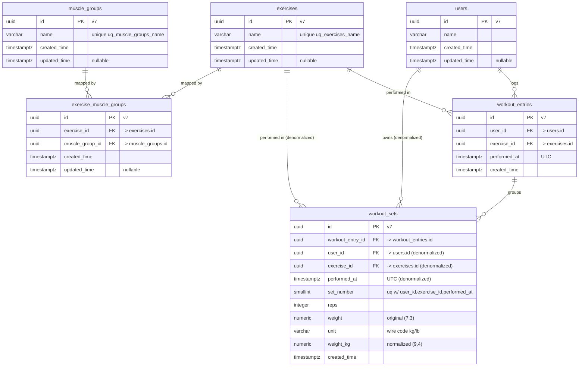

# System Architecture — Everfit Workout Logging API

Sprint: 2026-10-05 → 2026-10-09
Status: DRAFT for human confirmation (no implementation yet).
Inputs: `goal.md` (approved decisions), `features.md` (F1–F9), each task's `description.txt`,
`docs/guidelines/**`.

This document is the system-level design. Each task's `architecture-design.md` (sibling of its
`description.txt`) is consistent with the decisions here and must not contradict them.

> **Live DB check:** the `everfit-postgres` container is up and reachable, but the `everfit`
> database currently has **no tables** (`\dt` → "Did not find any relations"). Persistence is
> greenfield: there are no existing entities/migrations. This design is grounded in the entity
> sources to be created, not a pre-existing schema.

---

## 1. Guideline conformance & one flagged tension

Everything below follows `docs/guidelines/**`: modules under `src/modules/apis/<name>/` and
`src/modules/cores/<name>/`; interface-first services with injection-token enums and per-service
modules; thin controllers; explicit **Joi** validation via `JoiService`; TypeORM entities with
`Entity`-suffixed classes, UUID v7 ids, `timestamptz`, named constraints/indexes, and migrations;
the three-filter exception model; `DateTimeContext` for time; API docs gated by
`API_DOCUMENT__ENABLED`.

**Resolved (human-approved 2026-10-09) — wire codes & category-based units.** Units use a
**`ScaleUnit`** model (§6): each unit carries a stable `code` that IS the wire value (`'kg'` /
`'lb'` — lowercase, no `SNAKE_UPPER_CASE` on the wire), plus `name` and `description`, and belongs
to exactly one **category** (`ScaleUnitCategories` — `WEIGHT` this sprint; `LENGTH` is the
extension example). Conversion is category-aware and only valid **within** a category; a
cross-category conversion raises a domain error. The per-category unit enum values (e.g.
`WeightUnits.KILOGRAM = 'kg'`) therefore carry the wire code — a deliberate, human-approved
deviation from `generic.md`'s `SNAKE_UPPER_CASE`-enum-value rule, taken so the enum, the registry,
the DB `unit` column, and the wire all agree on one value and cannot drift. Storage stays
normalized in kg (the weight category's base); converted output is presentation-only.

---

## 2. Entity model

Row-per-set (Q1 Option B) with a **parent grouping row**. Two workout tables plus three
master-data tables and one join table.

### 2.1 `users` — `UserEntity` (mutable, `IMutableEntity`)

| Column         | Type          | Notes                                        |
| -------------- | ------------- | -------------------------------------------- |
| `id`           | `uuid` PK     | UUID v7; `pk_users`                          |
| `name`         | `varchar(200)`| display name                                 |
| `created_time` | `timestamptz` |                                              |
| `updated_time` | `timestamptz` | nullable                                     |

Minimal master record — existence validation only (F2). No profile management.

### 2.2 `exercises` — `ExerciseEntity` (mutable)

| Column         | Type           | Notes                                       |
| -------------- | -------------- | ------------------------------------------- |
| `id`           | `uuid` PK      | `pk_exercises`                              |
| `name`         | `varchar(200)` | unique — `uq_exercises_name`                |
| `created_time` | `timestamptz`  |                                             |
| `updated_time` | `timestamptz`  | nullable                                    |

### 2.3 `muscle_groups` — `MuscleGroupEntity` (mutable)

| Column         | Type           | Notes                                       |
| -------------- | -------------- | ------------------------------------------- |
| `id`           | `uuid` PK      | `pk_muscle_groups`                          |
| `name`         | `varchar(200)` | unique — `uq_muscle_groups_name`            |
| `created_time` | `timestamptz`  |                                             |
| `updated_time` | `timestamptz`  | nullable                                    |

### 2.4 `exercise_muscle_groups` — `ExerciseMuscleGroupEntity` (mutable) — M:N join (Q2)

| Column            | Type          | Notes                                                       |
| ----------------- | ------------- | ---------------------------------------------------------- |
| `id`              | `uuid` PK     | `pk_exercise_muscle_groups`                                |
| `exercise_id`     | `uuid` FK     | → `exercises.id`; `fk_exercise_muscle_groups_exercise_id` |
| `muscle_group_id` | `uuid` FK     | → `muscle_groups.id`; `fk_exercise_muscle_groups_muscle_group_id` |
| `created_time`    | `timestamptz` |                                                            |
| `updated_time`    | `timestamptz` | nullable                                                    |

- **Unique pair** — `uq_exercise_muscle_groups_exercise_id_muscle_group_id` (Q2: a mapping cannot
  be duplicated).
- Index `ix_exercise_muscle_groups_muscle_group_id` (muscle_group_id, exercise_id) to resolve
  "which exercises belong to this muscle group" for the history muscle-group filter (F6).

### 2.5 `workout_entries` — `WorkoutEntryEntity` (immutable, `IImmutableEntity`) — the parent

One row per logged (user, exercise, instant) — the grouping unit for one exercise in one log
action, and the **paginated unit** of history (F6). "50k+ entries" counts these rows.

| Column         | Type          | Notes                                                 |
| -------------- | ------------- | ----------------------------------------------------- |
| `id`           | `uuid` PK     | UUID v7 (time-ordered) — `pk_workout_entries`         |
| `user_id`      | `uuid` FK     | → `users.id`; `fk_workout_entries_user_id`            |
| `exercise_id`  | `uuid` FK     | → `exercises.id`; `fk_workout_entries_exercise_id`    |
| `performed_at` | `timestamptz` | the workout instant, stored UTC (Q3)                  |
| `created_time` | `timestamptz` |                                                       |

No `updated_time` — logs are append-only this sprint (no edit/delete; F5 out-of-scope).

### 2.6 `workout_sets` — `WorkoutSetEntity` (immutable) — the queryable fact row

One row per set (Q1). Carries the parent FK **and denormalized** `user_id`, `exercise_id`,
`performed_at` so PR aggregation and the uniqueness constraint need **no join** (see §4 rationale).

| Column             | Type           | Notes                                                     |
| ------------------ | -------------- | -------------------------------------------------------- |
| `id`               | `uuid` PK      | UUID v7 — `pk_workout_sets`                              |
| `workout_entry_id` | `uuid` FK      | → `workout_entries.id`; `fk_workout_sets_workout_entry_id` |
| `user_id`          | `uuid`         | denormalized from parent                                 |
| `exercise_id`      | `uuid`         | denormalized from parent                                 |
| `performed_at`     | `timestamptz`  | denormalized from parent (UTC)                          |
| `set_number`       | `smallint`     | 1-based ordinal within the entry (the repeat discriminator) |
| `reps`             | `integer`      | positive                                                 |
| `weight`           | `numeric(7,3)` | original value as entered                                |
| `unit`             | `varchar(8)`   | original wire unit code (`'kg'` / `'lb'`)               |
| `weight_kg`        | `numeric(9,4)` | normalized kg (storage canonical)                       |
| `created_time`     | `timestamptz`  |                                                          |

- **Duplicate-rejection unique constraint (Q8)** —
  `uq_workout_sets_user_id_exercise_id_performed_at_set_number` on
  `(user_id, exercise_id, performed_at, set_number)`.
  - Rationale: `set_number` distinguishes a **legitimate repeated identical set** (same reps/weight,
    different ordinal → allowed) from a **true duplicate** (same user+exercise+instant+ordinal →
    409). It is denormalized onto the set (not `(workout_entry_id, set_number)`) so that re-sending
    the same batch as a *new* parent entry with the same `performed_at` still collides — making it
    **race-safe at the DB** even across separate concurrent entries.
- A Postgres unique-violation (`23505`) is translated at the service boundary into a
  `WorkoutSetAlreadyExistsException` → HTTP **409** (`WORKOUT_ALREADY_EXISTS`).

### 2.7 Numeric / type choices

- Weights `numeric` (exact), not float — avoids rounding drift in stored kg and aggregation.
  `weight_kg` keeps 4 dp for conversion precision; display rounds to 2 dp (F4).
- All instants `timestamptz`, written as UTC (Q3). The injected `TimeContext.getUtcNowAsync()`
  supplies `created_time`/`performed_at` defaults; range and period math are UTC (§7).

### 2.7.1 Why store `weight_kg` (normalized storage)

`workout_sets` keeps **both** what the coach entered (`weight` + `unit`) **and** a normalized
`weight_kg`. The normalized column is deliberate, for four reasons:

1. **Requirement mandate.** The spec explicitly requires auto-converting and storing a normalized
   kg value **alongside** the original. `weight` + `unit` = exactly what the coach entered;
   `weight_kg` = the kg-normalized value derived from them.
2. **Cross-unit comparison.** A user may log some sets in kg and others in lb; raw `weight` values
   are **not comparable across units**. Normalizing to kg at write time lets every PR
   comparison/aggregation (F7/F8) operate on one consistent scale.
3. **Index-backed aggregation at 50k+.** The three PR expression indexes (**§3**) are built **on
   `weight_kg`** (`weight_kg DESC`; `reps * weight_kg`; `weight_kg * (1 + reps / 30)`). Only a
   pre-normalized **stored** column can be indexed; storing just `weight` + `unit` would force a
   per-row `CASE`-based conversion on every query → full scans. The stored column is what makes each
   PR an **O(log n) top-1 index scan** instead of a sequential scan.
4. **Lossless reads.** On output we convert `weight_kg` → the caller's required `unit`; keeping the
   original `weight` / `unit` too means we never lose what was entered (no lossy
   convert-and-round-trip). Storage stays kg; display converts to 2 dp (per **§2.7** / F4).

**Trade-off.** `weight_kg` is a **derived/duplicated** value that must stay correct. This is safe
here because sets are **immutable** (append-only — no edit/delete this sprint) and `weight_kg` is
computed **once at write time** by `IScaleUnitConversionService.toBaseAsync` inside the **same
transaction** as the insert (§8) — so it can never drift from `weight` / `unit`.

### 2.8 ER diagram

Visual of the full schema (kept consistent with the tables above, the §3 indexes, and the §2.6
unique constraint; mirror this in the developer-maintained DBML at
`docs/designs/database-diagram.txt`).



- `exercises` ⇄ `muscle_groups` is logical **many-to-many**, resolved through
  `exercise_muscle_groups` (each side `||--o{` the join; unique pair
  `uq_exercise_muscle_groups_exercise_id_muscle_group_id`).
- `workout_sets` carries **three denormalized FKs** (`user_id`, `exercise_id`, `performed_at`) copied
  from its parent `workout_entries` — shown as relationships from `users`/`exercises` — enabling the
  §3 index-backed PR aggregation and the §2.6 race-safe unique constraint
  `(user_id, exercise_id, performed_at, set_number)` without a parent join.

---

## 3. Indexing strategy (justified for 50k+)

History filtering (F6) and PR aggregation (F7/F8) are the two hot read paths. The index set:

**History (keyset over `workout_entries`):**
1. `ix_workout_entries_user_id_performed_at_id` on `(user_id, performed_at DESC, id DESC)` —
   backs the default keyset page `WHERE user_id = ? AND (performed_at, id) < (?, ?) ORDER BY
   performed_at DESC, id DESC LIMIT n+1`. Stable under concurrent inserts (keyset, not offset).
2. `ix_workout_entries_user_id_exercise_id_performed_at` on
   `(user_id, exercise_id, performed_at DESC)` — when the exercise filter resolves to one
   exercise, Postgres narrows on exercise_id while preserving ordering.
   - Partial-name exercise filter and muscle-group filter are resolved to a **set of
     `exercise_id`s** from the small catalogue (ILIKE / join on `exercise_muscle_groups`), then
     applied as `exercise_id = ANY(:ids)` against index (1). The catalogue is tiny; an optional
     `pg_trgm` index on `exercises.name` is noted as a future optimization, not required.

**PR aggregation (top-1 over `workout_sets`):** three descending/expression indexes make each PR a
`ORDER BY <metric> DESC, performed_at ASC LIMIT 1` index scan (O(log n), not a full scan):
3. `ix_workout_sets_user_id_exercise_id_weight_kg` on `(user_id, exercise_id, weight_kg DESC)` —
   **max weight**.
4. `ix_workout_sets_user_id_exercise_id_volume` on
   `(user_id, exercise_id, ((reps * weight_kg)) DESC)` — **max volume** (expression index).
5. `ix_workout_sets_user_id_exercise_id_epley` on
   `(user_id, exercise_id, ((weight_kg * (1 + reps / 30.0))) DESC)` — **best Epley 1RM** (expression
   index).
6. `ix_workout_sets_user_id_exercise_id_performed_at` on
   `(user_id, exercise_id, performed_at DESC)` — **period-bounded** PR (F8): the `performed_at`
   range predicate narrows the scan to one week/month/year before the top-1 is taken.

- Tie-break for all PRs: **earliest `performed_at` wins** (`ORDER BY <metric> DESC, performed_at
  ASC, id ASC`) so "when it was first achieved" is deterministic.
- FKs are indexed (either as the leading column of the above or explicitly on the join table) to
  keep inserts and referential checks cheap.

Trade-off documented: denormalizing `user_id`/`exercise_id`/`performed_at` onto `workout_sets`
duplicates three columns per set, but removes a parent join from every aggregation and lets the
uniqueness constraint be race-safe. Because sets are **immutable** and written in the same
transaction as their parent entry (§8), the denormalized values can never drift.

---

## 4. Module map

### Shared `src/common/` (cross-cutting, not a feature module)

- `constants/business-exception-codes.ts` — `BusinessExceptionCodes` enum (extended; see §5).
- `exceptions/` — `business.exception.ts`, `validation.exception.ts` (exist).
- `filters/` — three filters + `exception-filter.module.ts` (exist).
- `models/` — `validation-issue.ts` (exists), `search-result.ts` (`SearchResult<T>`), `pager.ts`.
- `entities/` — `immutable-entity.interface.ts`, `mutable-entity.interface.ts` (exist).
- `time-context/` — `ITimeContext` / `TimeContext` / tokens / module (per `time-context.md`).
- `services/joi/` — `IJoiService` / `JoiService` / tokens / module (per `request-validation.md`).
- `schemas/` — reusable Joi: `user-id.joi-schema.ts`, `exercise-name.joi-schema.ts`,
  `weight-unit.joi-schema.ts`, `offset-pager.joi-schema.ts`, `cursor-pager.joi-schema.ts`,
  `date-range` fields.
- `config/` — config namespaces + boot-time env Joi validation (`database`, `apiDocument`).
- `data-source.ts` — TypeORM CLI data source for migrations.
- `migrations/` — TypeORM migrations.

### Core modules `src/modules/cores/` (shared logic, no `/api` controllers)

- `user/` — `UserEntity`; `services/user/` (`IUserService`: `getByIdAsync`, `existsByIdAsync`,
  `createAsync`); `UserByIdNotFoundException`. Exports `SERVICE__USER`.
- `exercise/` — `ExerciseEntity`, `MuscleGroupEntity`, `ExerciseMuscleGroupEntity`;
  `services/exercise/` (`IExerciseService`: `getByIdAsync`, `existsByIdAsync`, `searchAsync`
  (offset), `resolveIdsByNameLikeAsync`, `resolveIdsByMuscleGroupIdAsync`, `createAsync`,
  `mapMuscleGroupAsync`); `services/muscle-group/` (`IMuscleGroupService`: `searchAsync` (offset),
  `getByIdAsync`, `existsByIdAsync`, `createAsync`); `ExerciseByIdNotFoundException`,
  `MuscleGroupByIdNotFoundException`, `ExerciseMuscleGroupAlreadyExistsException`.
- `scale-unit/` — `ScaleUnitCategories` enum, per-category unit enums (`WeightUnits`; `LengthUnits`
  is the extension example), `ScaleUnit` model, `ScaleUnitDefinitions` registry;
  `services/scale-unit-conversion/` (`IScaleUnitConversionService`: `convertAsync`, `toBaseAsync`,
  `fromBaseAsync`, `isSupported`, `getCategory`, `getCodesByCategory`);
  `UnsupportedScaleUnitException`, `CrossCategoryConversionException`. Exports
  `SERVICE__SCALE_UNIT_CONVERSION`.
- `workout/` — `WorkoutEntryEntity`, `WorkoutSetEntity`; `services/workout/`
  (`IWorkoutService`: `createManyAsync` transactional bulk; `searchHistoryAsync` keyset;
  `getPersonalRecordsAsync(criteria)`; `getPersonalRecordsForPeriodAsync(criteria)`);
  `WorkoutSetAlreadyExistsException`. Exports `SERVICE__WORKOUT`.

### API modules `src/modules/apis/` (thin controllers + orchestration services)

- `user/` — `UserApiController`: `GET /api/users` (offset list), `GET /api/users/:id`
  (read-only discovery so graders can find seeded ids). Delegates to core user service.
- `exercise/` — `ExerciseApiController`: `GET /api/exercises` (offset list — realizes the
  offset-pagination half of Q4).
- `muscle-group/` — `MuscleGroupApiController`: `GET /api/muscle-groups` (offset list).
- `workout/` — `WorkoutApiController`: `POST /api/workout` (single + bulk, F5);
  `services/workout-logging/` orchestration service (`IWorkoutLoggingService.logAsync`).
- `workout-history/` — `WorkoutHistoryApiController`: `GET /api/workout-history` (F6);
  `services/workout-history-query/` orchestration service.
- `personal-record/` — `PersonalRecordApiController`: `GET /api/personal-record` (F7),
  `GET /api/personal-record/comparison` (F8); `services/personal-record-query/` orchestration.

### Standalone CLI `src/cli/` (F9 — not an API)

- A Nest standalone-application command (`database-cli`) with `reset` and `seed` operations, run
  via an Nx target. Reuses the core services/entities; batched inserts for 50k+.

---

## 5. Exception model & error-code catalogue

Three filters already exist (`ValidationExceptionFilter` → 400, `BusinessExceptionFilter` →
declared status, `UnhandledExceptionFilter` → 500) and are registered via `APP_FILTER` in
`ExceptionFilterModule`. The stable `BusinessExceptionCodes` enum is extended to:

```
VALIDATION_ISSUE, UNHANDLED,                  (exist)
USER_NOT_FOUND,                               (F2)
EXERCISE_NOT_FOUND, MUSCLE_GROUP_NOT_FOUND,   (F3)
EXERCISE_MUSCLE_GROUP_ALREADY_EXISTS,         (F3)
UNSUPPORTED_SCALE_UNIT, CROSS_CATEGORY_CONVERSION,  (F4)
WORKOUT_ALREADY_EXISTS,                        (F5 — 409)
INVALID_CURSOR                                 (F6 — surfaced as a 400 ValidationException)
```

One `BusinessException` subclass per code (naming per `api.md` §3.4 / `error-handling.md` §2.3).
`UNSUPPORTED_SCALE_UNIT` and `CROSS_CATEGORY_CONVERSION` are `BusinessException`s (400) for the
service-boundary cases; Joi rejects unknown units at the request boundary as `VALIDATION_ISSUE`
(also 400) before the service runs.
Invalid cursor is raised as a `ValidationException` (400) from the history orchestration service.

---

## 6. Unit-conversion strategy — category-based `ScaleUnit` (extensibility)

Single source of truth in code (F4), injectable, no scattered `if`, **category-aware** so
conversion is only ever valid within one category and the model extends by adding a unit to a
category or a whole new category with minimal change:

- `ScaleUnitCategories` enum (`src/modules/cores/scale-unit/constants/`): `WEIGHT = 'WEIGHT'` this
  sprint; `LENGTH` is the documented extension example (not shipped).
- Per-category **unit enums** (the extension axis): `WeightUnits { KILOGRAM = 'kg', POUND = 'lb' }`
  (values are the wire codes — human-approved, §1); `LengthUnits` would be added the same way.
- `ScaleUnit` model — `{ code: string; name: string; description: string; category:
  ScaleUnitCategories; factorToBase: number }`. `factorToBase` converts to the category's **base
  unit** (kg for `WEIGHT`). Example: `{ code: 'lb', name: 'Pound', description: '…', category:
  WEIGHT, factorToBase: 0.45359237 }`; `{ code: 'kg', …, factorToBase: 1 }` (kg is the weight base).
- `ScaleUnitDefinitions` — the registry (a `const` list grouped/derivable by category) holding every
  `ScaleUnit`. **Adding a unit (e.g. stone) = one unit-enum member + one registry entry; adding a
  category = a new category member + its unit enum + its registry entries** — no other code changes.
- `IScaleUnitConversionService` (interface-first, token `SERVICE__SCALE_UNIT_CONVERSION`):
  - `convertAsync(value, fromCode, toCode)` — the category-aware core; if `fromCode`/`toCode` are in
    **different** categories → `CrossCategoryConversionException`; if a code is unknown →
    `UnsupportedScaleUnitException`.
  - `toBaseAsync(value, code)` — normalize to the category base on write (weight → kg; storage stays
    kg).
  - `fromBaseAsync(valueBase, code)` — display conversion on read, rounded to **2 dp**.
  - `isSupported(code)`, `getCategory(code)`, `getCodesByCategory(category)` — the last drives the
    reusable `weightUnitJoiSchema`.
  - Unknown code reaching any method (past Joi) → `UnsupportedScaleUnitException`.
- Joi `weightUnitJoiSchema = Joi.string().valid(...getCodesByCategory(WEIGHT))` — a single reusable
  schema so the accepted read/log unit set never drifts from the registry. (Named for the weight
  category it validates; a future category would get its own schema.)

The exercise→muscle-group mapping is **relational configuration** (the join table, §2.4), resolved
by `IExerciseService` — not hardcoded business logic (F3 extensibility).

---

## 7. Time & period strategy

- `TimeContext.getUtcNowAsync()` is the only clock (`time-context.md`). No `new Date()` outside it.
- Storage UTC (`timestamptz`); the DB/server timezone is irrelevant (Q3). History date-range filters
  (F6) use the UTC instants supplied by the caller.
- **Period boundaries (F8) are timezone-aware** (2026-10-10 decision). `getUtcNowAsync()` still
  supplies "now", but the comparison endpoint takes a **required `timezone`** (IANA name) and derives
  each window as a **local wall-clock instant in that zone**, then converts to a **UTC instant** for
  the `performed_at` query. Half-open `[start, end)`:
  - week: the week containing local "now", starting **Monday 00:00:00 local** (ISO-8601) → next
    Monday; previous = the week before.
  - month: **1st 00:00:00 local** → next month 1st; previous = prior calendar month (year rollover).
  - year: **Jan 1 00:00:00 local** → next Jan 1; previous = prior calendar year.
  - **DST/offset correctness:** local-midnight → UTC must respect the zone's offset **at that
    instant** (offsets shift across DST; a local midnight can be skipped/repeated). This requires a
    proper timezone/IANA library (developer's choice), not fixed-offset math. Computed by a **pure**
    boundary helper `(now, granularity, timezone) → PeriodWindow[]` (UTC instants), fakeable in tests.
  - Trade-offs (timezone-dependent windows; invalid zone → 400) documented in the README.

---

## 8. Transactions & write path (F5)

`IWorkoutService.createManyAsync` wraps the **entire batch** (all exercises, all sets) in one
TypeORM transaction (all-or-nothing, Q7). Within it: insert parent `workout_entries`, then their
`workout_sets` (denormalized fields copied from parent, `set_number` assigned per entry). A
`23505` unique violation anywhere aborts the transaction and is translated to
`WorkoutSetAlreadyExistsException` (409); unknown-user / unknown-exercise are caught **before** the
write (domain checks, §request-flow) and also abort the whole request.

---

## 9. API contracts (summary — detail in each task design)

Conventions: base `/api/<module>`, dash-case routes; lists → `SearchResult<T>`; `200` reads,
`201` create; errors `{ code, message }` (business) or `{ code, issues }` (validation).

| Method & route                         | Purpose                        | Pagination | Feature |
| -------------------------------------- | ------------------------------ | ---------- | ------- |
| `GET /api/users`                       | list users (discovery)         | offset     | F2      |
| `GET /api/users/:id`                   | get one user                   | —          | F2      |
| `GET /api/exercises`                   | list exercises                 | offset     | F3      |
| `GET /api/muscle-groups`               | list muscle groups             | offset     | F3      |
| `POST /api/workout`                    | log workout (single + bulk)    | —          | F5      |
| `GET /api/workout-history`             | workout history (filtered)     | **cursor** | F6      |
| `GET /api/personal-record`            | PRs for user+exercise          | —          | F7      |
| `GET /api/personal-record/comparison` | PR current-vs-previous period  | —          | F8      |

- `unit` is a **required** query param on every read that returns weights (history, PR, comparison);
  omission → 400 (M1).
- **Not-found semantics on reads:** an unknown `userId` → **404 `USER_NOT_FOUND`**; on the PR and PR
  comparison endpoints (`/api/personal-record`, `/api/personal-record/comparison`) an unknown
  `exerciseId` → **404 `EXERCISE_NOT_FOUND`** (validated before aggregation; 2026-10-10 decision,
  mirrors the unknown-user rule). A **known** user + **known** exercise with no matching data → an
  **empty result / null metrics at 200** (empty-not-error), never a 404.
- **PR comparison (`/api/personal-record/comparison`)** also takes a **required `timezone`** (IANA
  name, e.g. `Asia/Ho_Chi_Minh`); period boundaries are computed as local wall-clock in that zone and
  converted to UTC instants (§7). Invalid/missing `timezone` → **400**. The delta `direction` is one
  of `up`/`down`/`same`/`new` (previous null) / `none` (current null but previous present — D4).
- History pagination: opaque base64 `cursor` encoding `(performed_at, id)` + `limit`
  (1..100, default 20); response carries `nextCursor` (null at end).
- Offset lists: `limit` (1..100, default 20) + `offset` (≥0, default 0); response carries `total`.

### `SearchResult<T>` (common model)

```
SearchResult<T> {
  items: T[];
  limit: number;
  offset?: number;        // offset lists
  total?: number;         // offset lists
  nextCursor?: string | null;  // cursor lists
}
```

---

## 10. Cross-cutting: config, bootstrap, docs, Docker

- `ConfigModule` (layered, namespaced config + **boot-time Joi env validation**; no hardcoded
  secrets). Env files for the api project (confirmed O1 decision):
  - **`.env.api`** — the actual running env file for the api project (real values); **git-ignored**.
  - **`.env.api.example`** — the committed sample listing **every** env var the api project uses
    (names + example values, **no secrets**).
- `TypeOrmModule.forRootAsync` from `database` config; migrations run via CLI (no `synchronize`).
- `main.ts`: global prefix `api` (exists), CORS, env validation, and **OpenAPI + Scalar mounted
  only when `API_DOCUMENT__ENABLED === true`** (`@nestjs/swagger` document builder +
  `@scalar/nestjs-api-reference`; default off). `@ApiTags` plural-noun domain groups
  (`Users`, `Exercises`, `Muscle groups`, `Workouts`, `Personal records`), `@ApiOperation` titles.
- Dockerfile (multi-stage `nx build api` → slim Node) + `docker-compose.yml` (api + postgres);
  a compose for postgres already exists. `.env.api` supplies the api container's runtime env.

### New environment variables (api app)

| Variable                | Required | Default | Purpose                                  |
| ----------------------- | -------- | ------- | ---------------------------------------- |
| `NODE_ENV`              | no       | `development` | config layering / environment      |
| `PORT`                  | no       | `3000`  | HTTP port                                |
| `DATABASE__HOST`        | yes      | —       | Postgres host                            |
| `DATABASE__PORT`        | no       | `5432`  | Postgres port                            |
| `DATABASE__USERNAME`    | yes      | —       | Postgres user                            |
| `DATABASE__PASSWORD`    | yes      | —       | Postgres password                        |
| `DATABASE__NAME`        | yes      | —       | Postgres database name                   |
| `API_DOCUMENT__ENABLED` | no       | `false` | mount OpenAPI + Scalar when `true`       |

---

## 11. Build order & dependencies

`F1 → (F2 ∥ F3 ∥ F4) → F5 → (F6 ∥ F7 ∥ F9); F7 → F8`. Tasks are designed in this order; shared
entities/services are settled upstream before dependents are designed.

## 12. Resolved refinements (human-approved 2026-10-09) & open gaps

- **Unit model** (§1, §6) — **RESOLVED**: category-based `ScaleUnit` (wire codes `'kg'`/`'lb'`;
  conversion valid only within a category; cross-category → domain error). Scope updated in F4 /
  Task 4.
- **Read-only discovery endpoints** (`GET /api/users`, `/api/exercises`, `/api/muscle-groups`,
  offset-paginated) — **RESOLVED**: human-approved, now in F2/F3 and Tasks 2/3. `GET /api/exercises`
  includes each exercise's mapped muscle groups and an optional partial-name filter.
- No existing **tests** require modification (the scaffolded `app.*.spec.ts` are kept; see Task 1).
- **Open gaps:** none outstanding.
